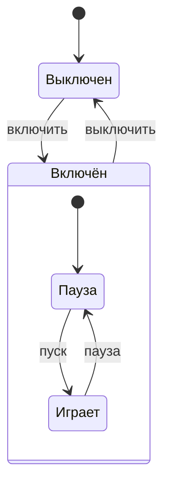

# Группа: ИКТГ-2522
Владелец репозитория: Калганова Екатерина\
Состав коллектива: Калганова Екатерина, Пимахина Юлия\
Вариант №16\
Реализация "Плеера"

1. Модель плеера, описание поведения устройства

Свойства
   
| Свойство  | Тип | Допустимые значения |
| -------------  | ------------- | ------------- |
| power          | bool  | false – выключен, true – включён |
| playing        | bool  | false – пауза, true – играет (только если power = true) |
| volume         | int   | от 0 до 10 |
| track  | int   | от 1 до 5  |

Методы
changePower(), changePlay(), volumeUp(), volumeDown(), nextTrack(), prevTrack().     Дополнительно есть setVolume(), setTrack(), show() и методы для чтения свойств.

Таблица состояний
   
| № | power | playing | Описание состояния |
| ------------- | ------------- | ------------- | ------------- |
| 1  | false  | false | Плеер выключен |
| 2  | true | false | Плеер включён, пауза |
| 3  | true  | true | Плеер включён, воспроизведение музыки |

Диаграмма состояний



   
1. Создание объекта с помощью конструктора по умолчанию
   ```cpp
   Player p1;
   p1.show();
   ```
   Вывод:
   ```
   Плеер выключен
   ```
   
2. Создание объекта с помощью конструктора с параметрами
   ```cpp
   Player p2(true, false, 7, 3);
   p2.show();
   ```
   Вывод:
   ```
   Плеер включён. Состояние: пауза. Громкость: 7. Трек: 3
   ```
   
3. Создание массива объектов
   
  ! /ИЗМЕНИТЬ! ТУТ Я НЕ ПРОЧИТАЛА ЧТО В ОТЧЕТЕ ДОЛЖЕН БЫТЬ МАССИВ... СКОРЕЕ ВСЕГО БУДЕТ СДЕЛАНО ПРОСТО НЕСКОЛЬКО ПЛЕЕРОВ

4. Редактирование и просмотр свойств каждого объекта

   /ИЗМЕНИТЬ! ТУТ Я НЕ ПРОЧИТАЛА ЧТО В ОТЧЕТЕ ДОЛЖЕН БЫТЬ МАССИВ... СКОРЕЕ ВСЕГО БУДЕТ СДЕЛАНО ПРОСТО НЕСКОЛЬКО ПЛЕЕРОВ
   
5. Обработка массива объектов
   /ИЗМЕНИТЬ! ТУТ Я НЕ ПРОЧИТАЛА ЧТО В ОТЧЕТЕ ДОЛЖЕН БЫТЬ МАССИВ... СКОРЕЕ ВСЕГО БУДЕТ СДЕЛАНО ПРОСТО НЕСКОЛЬКО ПЛЕЕРОВ
7. Файл main.cpp (измен.)
   /ИЗМЕНИТЬ! ТУТ Я НЕ ПРОЧИТАЛА ЧТО В ОТЧЕТЕ ДОЛЖЕН БЫТЬ МАССИВ... СКОРЕЕ ВСЕГО БУДЕТ СДЕЛАНО ПРОСТО НЕСКОЛЬКО ПЛЕЕРОВ
Демонстрация работы программы 

https://github.com/user-attachments/assets/71ae1fd3-c5cd-4065-a186-606acc77f0cc

Заключение
