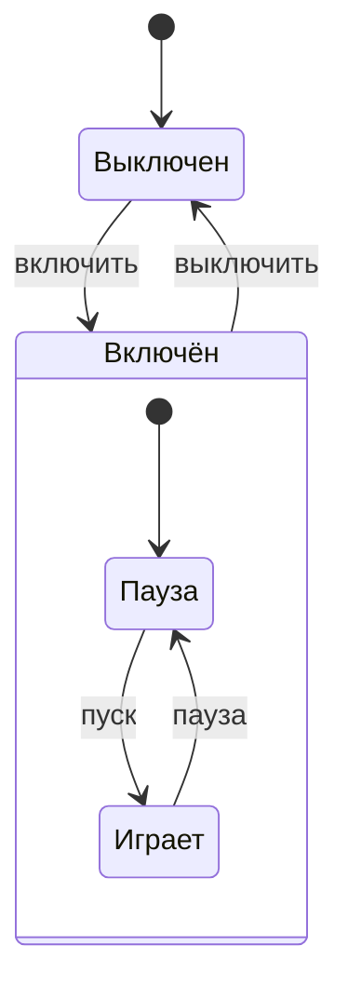

# Группа: ИКТГ-2522
Владелец репозитория: Калганова Екатерина\
Состав коллектива: Калганова Екатерина, Пимахина Юлия\
Вариант №16\
Реализация "Плеера"

1. Модель плеера, описание поведения устройства

Свойства
   
| Свойство  | Тип | Допустимые значения |
| -------------  | ------------- | ------------- |
| power          | bool  | false – выключен, true – включён |
| playing        | bool  | false – пауза, true – играет (только если power = true) |
| volume         | int   | от 0 до 10 |
| track  | int   | от 1 до 5  |

Методы
changePower(), changePlay(), volumeUp(), volumeDown(), nextTrack(), prevTrack().     Дополнительно есть setVolume(), setTrack(), show() и методы для чтения свойств.

Таблица состояний
   
| № | power | player | Описание состояния |
| ------------- | ------------- | ------------- | ------------- |
| 1  | false  | false | Плеер выключен |
| 2  | true | false | Плеер включён, пауза |
| 3  | true  | true | Плеер включён, воспроизведение музыки |

Диаграмма состояний

   
1. Создание объекта с помощью конструктора по умолчанию
2. Создание объекта с помощью конструктора с параметрами
3. Создание массива объектов
4. Редактирование и просмотр свойств каждого объекта
5. Обработка массива объектов
6. Файл main.cpp (измен.)
Заключение
