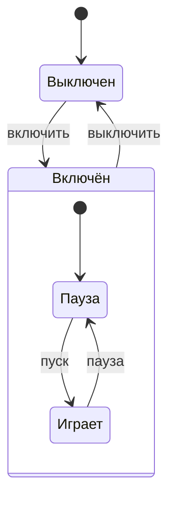

# Группа: ИКТГ-2522
Владелец репозитория: Калганова Екатерина\
Состав коллектива: Калганова Екатерина, Пимахина Юлия\
Вариант №16\
Реализация "Плеера"

***

<h2>1. Модель плеера, описание поведения устройства</h2>

Свойства
   
| Свойство  | Тип | Допустимые значения |
| -------------  | ------------- | ------------- |
| power          | bool  | false – выключен, true – включён |
| playing        | bool  | false – пауза, true – играет (только если power = true) |
| volume         | int   | от 0 до 10 |
| track  | int   | от 1 до 5  |

Методы
```
changePower(), changePlay(), volumeUp(), volumeDown(), nextTrack(), prevTrack(),  setVolume(), setTrack(), show() и методы для чтения свойств.

```
Таблица состояний
   
| № | power | playing | Описание состояния |
| ------------- | ------------- | ------------- | ------------- |
| 1  | false  | false | Плеер выключен |
| 2  | true | false | Плеер включён, пауза |
| 3  | true  | true | Плеер включён, воспроизведение музыки |

Диаграмма состояний



   
<h2>2. Создание объекта с помощью конструктора по умолчанию</h2>

   ```cpp
   Player p1;
   p1.show();
   ```
   Вывод:
   ```
   Плеер выключен
   ```
   
<h2>3. Создание объекта с помощью конструктора с параметрами</h2>

   ```cpp
   Player p2(true, false, 7, 3);
   p2.show();
   ```
   Вывод:
   ```
   Плеер включён. Состояние: пауза. Громкость: 7. Трек: 3
   ```
   
<h2>4. Создание массива объектов</h2>

   ```cpp
   Player players[3];
   players[1] = Player(true, false, 3, 2);
   players[2] = Player(true, true, 8, 5);

   for (int i = 0; i < 3; i++)
   {
       std::cout << "Плеер " << i + 1 << ": ";
       players[i].show();
   }
   ```
   Вывод:
   ```
   Плеер 1: Плеер выключен
   Плеер 2: Плеер включён. Состояние: пауза. Громкость: 3. Трек: 2
   Плеер 3: Плеер включён. Состояние: играет. Громкость: 8. Трек: 5
   ```
   
<h2>5. Редактирование и просмотр свойств каждого объекта</h2>
   
    ```cpp
    players[0].changePower();
    players[0].setVolume(9);
    players[1].nextTrack();
    players[2].changePlay();

    for (int i = 0; i < 3; i++)
    {
       std::cout << "Плеер " << i + 1 << ": ";
       players[i].show();
    }
    ```
   Вывод:
   
   ```
   Плеер 1: Плеер включён. Состояние: пауза. Громкость: 9. Трек: 1
   Плеер 2: Плеер включён. Состояние: пауза. Громкость: 3. Трек: 3
   Плеер 3: Плеер включён. Состояние: пауза. Громкость: 8. Трек: 5
   ```
   
<h2>7. Обработка массива объектов</h2>

   ```cpp
   int onCount = 0;
   int playCount = 0;
   int sumVolume = 0;
   int maxVolume = -1;
   int maxIndex = 0;

   for (int i = 0; i < 3; i++)
   {
      if (players[i].getPower() == true)
       {
           onCount = onCount + 1;
           sumVolume = sumVolume + players[i].getVolume();

           if (players[i].getVolume() > maxVolume)
           {
               maxVolume = players[i].getVolume();
               maxIndex = i;
           }
       }
       if (players[i].getPlaying() == true)
       {
            playCount = playCount + 1;
       }
     }

   std::cout << "Включено плееров: " << onCount << std::endl;
   std::cout << "Играет плееров: " << playCount << std::endl;
   if (onCount > 0)
   {
       std::cout << "Средняя громкость включённых: " << (double)sumVolume / onCount << std::endl;
       std::cout << "Самый громкий плеер: " << maxIndex + 1 << " (громкость " << maxVolume << ")" << std::endl;
   }
   else
   {
       std::cout << "Все плееры выключены." << std::endl;
   }
   ```
   Вывод:
   ```
   Включено плееров: 2
   Играет плееров: 1
   Средняя громкость включённых: 5.5
   Самый громкий плеер: 3 (громкость 8)
   ```
   
<h2>8. Файл main.cpp</h2>

   ```cpp
   #include <iostream>
   #include <clocale>
   #include "player.h"

   int main()
   {
       Player players[3];
       players[1] = Player(true, false, 3, 2);
       players[2] = Player(true, true, 8, 5);

       int work = 1;
       int command;
       int index;
       int number;
       int value;
   
       while (work)
       {
           std::cout << std::endl;
           std::cout << "----- МЕНЮ -----" << std::endl;
           std::cout << "1 - Показать все плееры" << std::endl;
           std::cout << "2 - Включить/выключить плеер" << std::endl;
           std::cout << "3 - Пуск/пауза" << std::endl;
           std::cout << "4 - Громкость больше" << std::endl;
           std::cout << "5 - Громкость меньше" << std::endl;
           std::cout << "6 - Следующий трек" << std::endl;
           std::cout << "7 - Предыдущий трек" << std::endl;
           std::cout << "8 - Установить громкость" << std::endl;
           std::cout << "9 - Установить номер трека" << std::endl;
           std::cout << "10 - Обработка массива (статистика)" << std::endl;
           std::cout << "11 - Выход" << std::endl;
           std::cout << "Введите номер команды ";
           std::cin >> command;
   
           index = 0;
           if (command >= 2 && command <= 9)
           {
               std::cout << "Введите номер плеера (1-3): ";
               std::cin >> number;
               if (number < 1 || number > 3)
               {
                   std::cout << "Такого плеера нет" << std::endl;
                   continue;
               }
            index = number - 1;
        }

        switch (command)
        {
        case 1:
            for (int i = 0; i < 3; i++)
            {
                std::cout << "Плеер " << i + 1 << ": ";
                players[i].show();
            }
            break;
        case 2:
            players[index].changePower();
            players[index].show();
            break;
        case 3:
            players[index].changePlay();
            players[index].show();
            break;
        case 4:
            players[index].volumeUp();
            players[index].show();
            break;
        case 5:
            players[index].volumeDown();
            players[index].show();
            break;
        case 6:
            players[index].nextTrack();
            players[index].show();
            break;
        case 7:
            players[index].prevTrack();
            players[index].show();
            break;
        case 8:
            std::cout << "Введите громкость (0-10): ";
            std::cin >> value;
            players[index].setVolume(value);
            players[index].show();
            break;
         case 9:
            std::cout << "Введите номер трека (1-5): ";
            std::cin >> value;
            players[index].setTrack(value);
            players[index].show();
            break;
         case 10:
         {
            int onCount = 0;
            int playCount = 0;
            int sumVolume = 0;
            int maxVolume = -1;
            int maxIndex = 0;

            for (int i = 0; i < 3; i++)
            {
                if (players[i].getPower() == true)
                {
                    onCount = onCount + 1;
                    sumVolume = sumVolume + players[i].getVolume();

                    if (players[i].getVolume() > maxVolume)
                    {
                        maxVolume = players[i].getVolume();
                        maxIndex = i;
                    }
                }
                if (players[i].getPlaying() == true)
                {
                    playCount = playCount + 1;
                }
            }

            std::cout << "Включено плееров: " << onCount << std::endl;
            std::cout << "Играет плееров: " << playCount << std::endl;
            if (onCount > 0)
            {
                std::cout << "Средняя громкость включённых: " << (double)sumVolume / onCount << std::endl;
                std::cout << "Самый громкий плеер: " << maxIndex + 1 << " (громкость " << maxVolume << ")" << std::endl;
            }
            else
            {
                std::cout << "Все плееры выключены" << std::endl;
            }
            break;
        }
        case 11:
            work = 0;
            break;
        default:
            std::cout << "Нет такой команды" << std::endl;
        }
    }
    return 0;
   }
   ```
<h2>9. Тесты для проверки соответствия модели поведения устройства и результаты работы программы.</h2>

| № | действие | ожидаемый результат | соответствие диаграмме
| ------------- | ------------- | ------------- | ------------- |
| 1  | плеер 1, команда 2 | включён, пауза, громкость 5, трек 1 | выключен -> пауза |
| 2  | плеер 1, команда 3 | играет | пауза -> играет |
| 3  | плеер 1, команда 3 ещё раз | пауза | играет -> пауза |
| 4  | плеер 1, команда 2  | выключен | пауза -> выключен |
| 5  | выключенный плеер, команда 3 | сообщение «Плеер выключен», состояние не меняется | перехода нет |
| 6  | плеер 3 (громкость 8), команда 4 три раза | Громкость 10, затем сообщение о максимуме | состояние не меняется |
| 7  | плеер 2, команда 8, значение 15 | ошибка, громкость прежняя | недопустимое значение |

<h2>Демонстрация работы программы</h2>

https://github.com/user-attachments/assets/5b1a0c58-d2e5-45a1-b45b-7e6dc9340e8b

<h2>10. Контрольные вопросы</h2>
1) Что такое свойства, состояния, события и переходы?

```
Свойства - это характеристики объекта, которые хранятся в его переменных. У плеера это power (питание), playing (воспроизведение), volume (громкость), track (номер трека)
Состояние - конкретный набор значений свойств в данный момент. Например, «плеер включён, играет музыка» (power = true, playing = true).
Событие - действие или условие, которое происходит с объектом и может изменить его состояние. У плеера это нажатие кнопки «включить», «пуск», «пауза», «выключить».
Переход - смена одного состояния другим, которая происходит при наступлении события. Например, переход «пауза -> играет» по событию «пуск».
```
2) Чем определяется состояние объекта?

```
Состояние объекта определяется значениями его свойств в данный момент времени. Если значения свойств изменились - объект перешёл в другое состояние.
```

3) Что такое инкапсуляция?
```
Инкапсуляция – это объединение данных и методов в одном классе и закрытие данных от прямого доступа, чтобы их можно было изменять только через методы класса с проверкой допустимых значений.
```
4) Что представляет собой модуль в C/C++?

```
Модуль – это отдельная логически завершённая часть программы, состоящая из двух файлов с одним именем: заголовочного файла *.h (интерфейс, то есть что модуль умеет) и файла реализации *.cpp. Модули подключаются друг к другу директивой #include, а при сборке проекта объединяются в одну программу.
```

5) Какая часть кода класса может находиться в файле *.h?
```
В файле *.h находится интерфейсная часть: объявление класса (ключевое слово class, имя), объявления свойств и прототипы методов (без тела), разделы public и private. Обязательно нужна защита от повторного подключения директивами #ifndef, #define, #endif.
```
6) В каком файле находится реализация функций-членов класса?

```
В файле реализации *.cpp. У нас это player.cpp: там записаны тела конструкторов и методов в виде Player::changePower(), Player::volumeUp() и т.д. Запись Player:: показывает, что функция принадлежит классу. Для связи с интерфейсом в начале файла обязательно подключается заголовочный файл: #include "player.h".
```

7) Сколько файлов будет содержать проект-консольное приложение, если в проекте созданы два класса?

```
Итого 5 файлов: по 2 файла на каждый класс (*.h и *.cpp) и один файл главного модуля ( main() )
```

<h2>Заключение</h2>
В ходе работы был разработан класс "player", моделирующий работу плеера. Свойства класса закрыты (private), а методы открыты (public), что обеспечивает изменение состояний объекта только через методы с проверкой допустимых значений. Реализованы конструктор по умолчанию и конструктор с параметрами. Класс размещён в отдельном модуле (player.h и player.cpp). Создан массив объектов (3 плеера), и с ним выполнены просмотр, редактирование и обработка. Работа плеера проверена тестами, результаты которых соответствуют диаграмме состояний.
